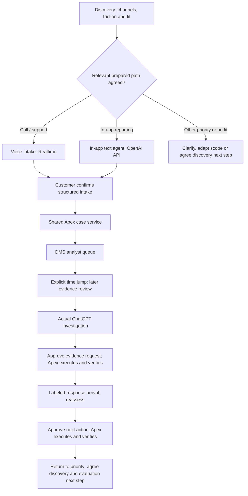

# Running discovery and outcomes

Updated October 20, 2026 (America/Los_Angeles). Maintain this document as discovery and user decisions evolve. This is a facilitator plan; no fictional customer answers below are actual discovery findings.

## Discovery approach — locked October 20, 2026

Theo approved this approach during interview preparation: use focused questions that let the customer correct the hypothesis. Bring premeeting knowledge, listen, ask one clarifying follow-up, and adapt the recommendation. Do not steer every answer toward the same pitch. These are prepared prompts and response options, not completed discovery or a rehearsed exchange.

### Opening prompts

1. **Intake:** “Walk me through how customers initiate disputes today. Which channels account for most of the volume, and where does the intake process create the most friction?”
   - Follow-up when useful: “What information is typically missing when the case reaches an analyst, and what happens next?”
   - Phone and in-app are prepared demonstration paths, not an exhaustive list of customer channels. For example, [Capital One lists app, website, phone and mail](https://www.capitalone.com/help-center/fraud-disputes/dispute-credit-charge/). Apex's actual fictional channel mix remains uncollected. Do not invent support for chat, branch intake or any particular channel.
2. **Analyst work:** “Once a dispute reaches your team, walk me through how an analyst investigates it. Which steps take the most hands-on time?”
   - Follow-up: “What makes that step difficult—and what does the analyst have to do when the information is incomplete or conflicting?”
   - When the three-minute budget calls for a narrower hypothesis: “From our preparation, evidence gathering and reconciliation look like major sources of analyst effort. How closely does that match what your team experiences?”
3. **Success:** “What would a meaningful improvement look like for your team, and how do you measure that today?” Follow up: “What would need to stay at least as good?” Agree the outcome before proposing a pilot target; see [discovery-to-pilot sequencing](discovery-to-pilot.md).

Pause after each question. Select the highest-value follow-up; these are alternatives within the existing three-minute opening, not an expanded questionnaire. Once the channel/process is understood, agree which relevant prepared intake route to explore. If another channel is the priority, clarify its friction and whether a prepared route illustrates an applicable pattern; disclose any mismatch rather than pretending that channel is built.

Avoid answer-feeding wording such as “Wouldn't automating evidence gathering solve your capacity problem?” The preparation hypothesis is evidence assembly/reconciliation plus incomplete-information rework; it remains subject to correction.

### Unexpected answers and how to respond

Acknowledge the answer, ask one clarifying question, then explain what changes. Keep listening before proposing.

| Customer answer | Clarify / adapt |
| --- | --- |
| “We mostly wait for merchants.” | “Is the bigger burden the elapsed wait, or the follow-up work your team does during it?” Focus on demonstrated active effort or follow-up if relevant; do not promise to remove external waiting. |
| “Our biggest issue is incomplete intake.” | Emphasize customer clarification, confirmed information and fewer downstream follow-ups. Validate the benefit in the pilot; do not claim measured rework reduction. |
| “Quality matters more than capacity.” | Emphasize source fidelity, conflicting evidence, uncertainty and analyst review. Make effort a secondary measure and revise the pilot's primary metric. |
| “We already automate evidence gathering.” | “Where does an analyst still have to interpret or reconcile what comes back?” Establish the remaining gap before recommending more automation. |
| The main problem falls outside this solution | “That changes where I'd start. Today's example addresses investigation effort; I wouldn't claim it solves that broader issue. Is that investigation step still worth exploring, or should we revisit the pilot scope?” Accept a changed scope or discovery next step instead of forcing a pilot. |

The interview coaching principle: demonstrate that discovery can change the recommendation. These responses are preparation guidance, not a private interviewer rubric or predictions of Joe's/Rory's behavior.

### Scenario and evidence boundaries reaffirmed

- Theo confirmed October 20 that Apex remains the fictional bank/issuer; the discussed switch to Visa as the customer was not adopted.
- Apex's 120,000 annual disputes, 60,000 eligible investigations and 15% growth remain scenario assumptions. Visa's 106 million global disputes in 2025 and 35% growth since 2019 remain network context; see [market evidence](market-evidence.md).
- More cases with flat staffing means more workload per analyst, not automatically more minutes required for each case. Customer dissatisfaction and poor experience are possible consequences to explore, not confirmed Apex results.
- Do not introduce a forecast that AI agents necessarily increase fraud or disputes without evidence. The existing capacity hypothesis is sufficient for this scenario.
- Existing ChatGPT Enterprise productivity use and capability/privacy/security/governance/safety selection reasons are fictional premeeting context; see [Why OpenAI](why-openai.md). They do not approve sensitive Card Ops data, API processing or writes.
- This update changes preparation only. It does not resume building, complete Gate 0, establish integrations, execute model evaluations or prove customer outcomes.

## Locked experience model

Theo locked three potential experiences: (1) Realtime voice support, (2) an OpenAI API-powered conversational agent in the web/iPhone banking app, and (3) analyst investigation in actual ChatGPT. Discovery selects 1 OR 2, followed by 3. Both intake agents clarify and prepare structured reports for customer confirmation, then use the shared Apex case service. A plain form alone does not fulfill the in-app branch. See demo-flow.md for the authoritative experience table and implementation boundaries.

## Assignment clarification — two product surfaces

The original assignment was checked. Our two selected product surfaces are ChatGPT and Platform/APIs. Voice and text are API modes, not two counted product surfaces. Discovery still selects which intake experience and pain to explore; prepare both alternatives, but both need not be live implementations. Label any simulated/prepared path. Do not force a voice interaction to satisfy a surface count. See the five-piece preparation pack linked from meeting-outline.md.

## Keep the end in mind

The meeting should establish value (less investigation effort and rework with decision quality preserved), credibility (evidence retrieval, analyst judgment, approved execution and verification), and commitment (sponsor workflow observation and evaluation design with owners; a bounded pilot remains conditional on the findings and readiness).

The executive close first earns sponsorship of workflow observation, baseline validation, boundaries and evaluation design. A pilot is a conditional proposal rather than an immediate launch commitment; see [the locked next-step language](discovery-to-pilot.md). A predetermined dispute verdict is not the meeting outcome. The operational demo ends in a verified supported next action; the implemented specialist handoff remains an iteration endpoint, not a locked financial disposition. Consumer resolution and network recovery stay separate.

## Running discovery table

D-01's prepared demo branching is confirmed by Theo. October 20 broadens intake discovery beyond those two prepared routes and locks the adaptive approach above. Other response mappings remain facilitator proposals derived from the agreed meeting baseline. All customer answers remain uncollected. Ask the highest-value questions within the three-minute opening; use the rest as follow-ups or pilot discovery, not a mandatory questionnaire.

| ID | Discovery question | If the answer emphasizes… | Demo response | Pilot/value connection | Actual answer / status |
| --- | --- | --- | --- | --- | --- |
| D-01 | Walk me through how customers initiate disputes today. Which channels account for most of the volume, and where does intake create the most friction? | Call or support friction | Follow the voice intake path using Realtime | Validate intake effort, handoff completeness, and downstream rework | Uncollected; branching decision confirmed |
| D-01b | After understanding the channel mix, agree which relevant prepared route to explore; do not force a phone/app binary | In-app reporting friction | Follow API-powered conversational in-app intake and customer-confirmed submission | Validate report completeness, follow-up effort, and case continuity | Uncollected; branching decision confirmed |
| D-02 | Once a dispute reaches your team, walk me through how an analyst investigates it. Which steps take the most hands-on time? Use the correctable evidence-gathering hypothesis if useful. | Gathering / interpretation / execution | Emphasize authorized retrieval / sourced comparison and follow-up / approval and verified update, respectively | Select baseline time measures; count downstream work | Uncollected; proposed mapping |
| D-03 | What would a meaningful improvement look like for your team, and how do you measure that today? What would need to stay at least as good? | Customer's priority outcome | Refer back to that priority during the demonstration and close | Agree primary metric plus quality guardrails; do not assume labor savings | Uncollected; proposed mapping |
| D-04 | What must remain under analyst control, and what would prevent approval of a pilot? | Authority, evidence quality, access, or execution concerns | Show relevant permissions, uncertainty, approval, and verification; disclose unfinished controls | Agree risk/security readiness and evaluation gates | Uncollected; proposed follow-up |
| D-05 | Who should join a workflow ride-along and evaluation-design session, and which case class should we observe? | Scope, access constraints, sponsor and owners | Agree discovery work and a follow-up review; pilot remains conditional | Validate baseline, boundaries, permitted access and owners before a launch decision | Uncollected; proposed close question |

If both intake channels matter, ask which to explore first. Show the selected branch in depth and acknowledge the other without doubling the demo. If neither answer is clear, ask a short follow-up; do not silently default to voice or invent a customer preference. If a chosen integration is unfinished, disclose that and use an explicitly labeled simulation/fallback.

## Branching flow

Both branches use the same case contract and preserve transaction and customer-statement provenance. The same case ID must follow through the journey. This flow is intended behavior, not a claim that all connections are implemented. The current banking form saves locally; voice is pending; the DMS uses a preseeded case. See demo-flow.md and handoff.md.

## Outcome traceability

| End in mind | Proof in the meeting | What remains to establish |
| --- | --- | --- |
| Useful improvement | Before/after tied to the pain the customer named | Actual baseline and measured improvement |
| Credible workflow | Same case across surfaces, source citations, evidence-driven reassessment | Working shared intake and actual ChatGPT/Realtime integrations |
| Retained control | Human approves exact action; Apex executes; independent read verifies result | Authenticated authority and recorded failure evaluations |
| Investment decision | Illustrative economics and conditional pilot proposal; immediate discovery/evaluation-design ask with proposed owners and measures | Customer commitment to discovery; baseline, boundaries, net costs, agreed evals and readiness gates before launch |

Keep the 30-minute structure (3 discovery / 6 solution / 18 demo / 3 close). The intake slot demonstrates the chosen route, not automatically voice. Realtime remains the voice-branch capability; the OpenAI API powers the text agent in the in-app branch; actual ChatGPT remains the shared analyst surface. Every intended path includes two OpenAI-powered experiences. The original brief's surface requirement is resolved: demonstrate ChatGPT plus Platform/APIs. It permits live or simulated workflows and does not require both voice and text modes to be built live.

## Running change log

| Date | Decision / clarification | Status |
| --- | --- | --- |
| 2026-10-20 | Outcome-led opening; immediate next step is Gemba/baseline/boundaries/evaluation design; pilot conditional on findings and gates | Locked by Theo; supersedes an immediate pilot-sponsorship ask |
| 2026-10-20 | Focused, correctable discovery; broader intake question; adapt to unexpected answers or revisit scope; retain issuer scenario | Locked by Theo; no actual customer answers or execution proof |
| 2026-10-15 | Pilot sponsorship is the meeting outcome; illustrative ROI and proposed targets are not measured results | Existing locked baseline |
| 2026-10-15 | Banking app, DMS, and actual ChatGPT have distinct responsibilities and shared case continuity | Confirmed |
| 2026-10-15 | Discovery answers choose voice versus in-app demonstration; voice is not the unconditional live path | Confirmed by Theo; supersedes earlier voice-default wording |
| 2026-10-15 | Three potential OpenAI experiences locked: Realtime voice OR API-powered in-app text agent, followed by actual ChatGPT investigation; both intake branches include customer confirmation and shared case creation | Locked by Theo; supersedes plain-form-only in-app demo |
| 2026-10-15 | Original brief verified: ChatGPT + Platform/APIs satisfy the two-product-surface requirement; Realtime/text are modes. Both discovery branches remain prepared; both need not be live implementations | Brief verified; simulation must be explicit |
| 2026-10-15 | Maintain a running discovery table, flow, and end-in-mind section in the repo | Requested by Theo |

For each future discovery session, record date, attributed answer, selected branch, changed emphasis, metric implications, and unresolved questions. Keep synthetic rehearsal answers labeled. Update decisions-and-artifacts.md and affected plan/flow documents when a decision changes. Do not mark proposals as approved or integrations as complete without evidence.

