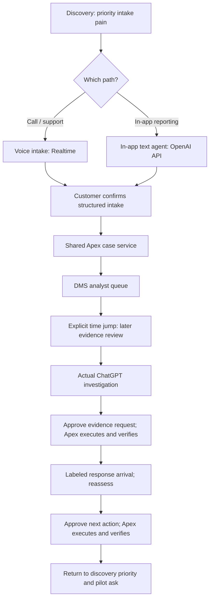

# Running discovery and outcomes

Updated October 15, 2026 (America/Los_Angeles). Maintain this document as discovery and user decisions evolve. This is a facilitator plan; no fictional customer answers below are actual discovery findings.

## Locked experience model

Theo locked three potential experiences: (1) Realtime voice support, (2) an OpenAI API-powered conversational agent in the web/iPhone banking app, and (3) analyst investigation in actual ChatGPT. Discovery selects 1 OR 2, followed by 3. Both intake agents clarify and prepare structured reports for customer confirmation, then use the shared Apex case service. A plain form alone does not fulfill the in-app branch. See demo-flow.md for the authoritative experience table and implementation boundaries.

## Keep the end in mind

The meeting should establish value (less investigation effort and rework with decision quality preserved), credibility (evidence retrieval, analyst judgment, approved execution and verification), and commitment (sponsor a bounded pilot with owners and measurable success criteria).

The executive close is pilot sponsorship, not a predetermined dispute verdict. The operational demo ends in a verified supported next action; the implemented specialist handoff remains an iteration endpoint, not a locked financial disposition. Consumer resolution and network recovery stay separate.

## Running discovery table

D-01's branching behavior is confirmed by Theo. Remaining prompts and response mappings are facilitator proposals derived from the agreed meeting baseline. All customer answers remain uncollected. Ask the highest-value questions within the three-minute opening; use the rest as follow-ups or pilot discovery, not a mandatory questionnaire.

| ID | Discovery question | If the answer emphasizes… | Demo response | Pilot/value connection | Actual answer / status |
| --- | --- | --- | --- | --- | --- |
| D-01 | When customers report an unfamiliar charge, do they typically call support or start in your banking app? Which experience most needs improvement? | Call or support friction | Follow the voice intake path using Realtime | Validate intake effort, handoff completeness, and downstream rework | Uncollected; branching decision confirmed |
| D-01b | Same question; alternative branch | In-app reporting friction | Follow API-powered conversational in-app intake and customer-confirmed submission | Validate report completeness, follow-up effort, and case continuity | Uncollected; branching decision confirmed |
| D-02 | Where do analysts lose the most time: gathering evidence, interpreting conflicts, or completing the next action? | Gathering / interpretation / execution | Emphasize authorized retrieval / sourced comparison and follow-up / approval and verified update, respectively | Select baseline time measures; count downstream work | Uncollected; proposed mapping |
| D-03 | What would make the pilot valuable: capacity, less rework, faster responses, or consistency? | Customer's priority outcome | Refer back to that priority during the demonstration and close | Agree primary metric plus quality guardrails; do not assume labor savings | Uncollected; proposed mapping |
| D-04 | What must remain under analyst control, and what would prevent approval of a pilot? | Authority, evidence quality, access, or execution concerns | Show relevant permissions, uncertainty, approval, and verification; disclose unfinished controls | Agree risk/security readiness and evaluation gates | Uncollected; proposed follow-up |
| D-05 | Which case class and systems could support a bounded pilot, and who would own it? | Scope, access constraints, sponsor and owners | Narrow pilot proposal to feasible workflow | Confirm operations/technology owners and approved data access | Uncollected; proposed close question |

If both intake channels matter, ask which to explore first. Show the selected branch in depth and acknowledge the other without doubling the demo. If neither answer is clear, ask a short follow-up; do not silently default to voice or invent a customer preference. If a chosen integration is unfinished, disclose that and use an explicitly labeled simulation/fallback.

## Branching flow

Both branches use the same case contract and preserve transaction and customer-statement provenance. The same case ID must follow through the journey. This flow is intended behavior, not a claim that all connections are implemented. The current banking form saves locally; voice is pending; the DMS uses a preseeded case. See demo-flow.md and handoff.md.

## Outcome traceability

| End in mind | Proof in the meeting | What remains to establish |
| --- | --- | --- |
| Useful improvement | Before/after tied to the pain the customer named | Actual baseline and measured improvement |
| Credible workflow | Same case across surfaces, source citations, evidence-driven reassessment | Working shared intake and actual ChatGPT/Realtime integrations |
| Retained control | Human approves exact action; Apex executes; independent read verifies result | Authenticated authority and recorded failure evaluations |
| Investment decision | Illustrative economics, scoped pilot, named owners and agreed measures | Customer commitments; net costs; readiness gates |

Keep the 30-minute structure (3 discovery / 6 solution / 18 demo / 3 close). The intake slot demonstrates the chosen route, not automatically voice. Realtime remains the voice-branch capability; the OpenAI API powers the text agent in the in-app branch; actual ChatGPT remains the shared analyst surface. Every intended path includes two OpenAI-powered experiences. No decision has been made here about whether an external interview rubric requires both capabilities to be visibly demonstrated regardless of branch; check the original brief if that question arises.

## Running change log

| Date | Decision / clarification | Status |
| --- | --- | --- |
| 2026-10-15 | Pilot sponsorship is the meeting outcome; illustrative ROI and proposed targets are not measured results | Existing locked baseline |
| 2026-10-15 | Banking app, DMS, and actual ChatGPT have distinct responsibilities and shared case continuity | Confirmed |
| 2026-10-15 | Discovery answers choose voice versus in-app demonstration; voice is not the unconditional live path | Confirmed by Theo; supersedes earlier voice-default wording |
| 2026-10-15 | Three potential OpenAI experiences locked: Realtime voice OR API-powered in-app text agent, followed by actual ChatGPT investigation; both intake branches include customer confirmation and shared case creation | Locked by Theo; supersedes plain-form-only in-app demo |
| 2026-10-15 | Maintain a running discovery table, flow, and end-in-mind section in the repo | Requested by Theo |

For each future discovery session, record date, attributed answer, selected branch, changed emphasis, metric implications, and unresolved questions. Keep synthetic rehearsal answers labeled. Update decisions-and-artifacts.md and affected plan/flow documents when a decision changes. Do not mark proposals as approved or integrations as complete without evidence.
