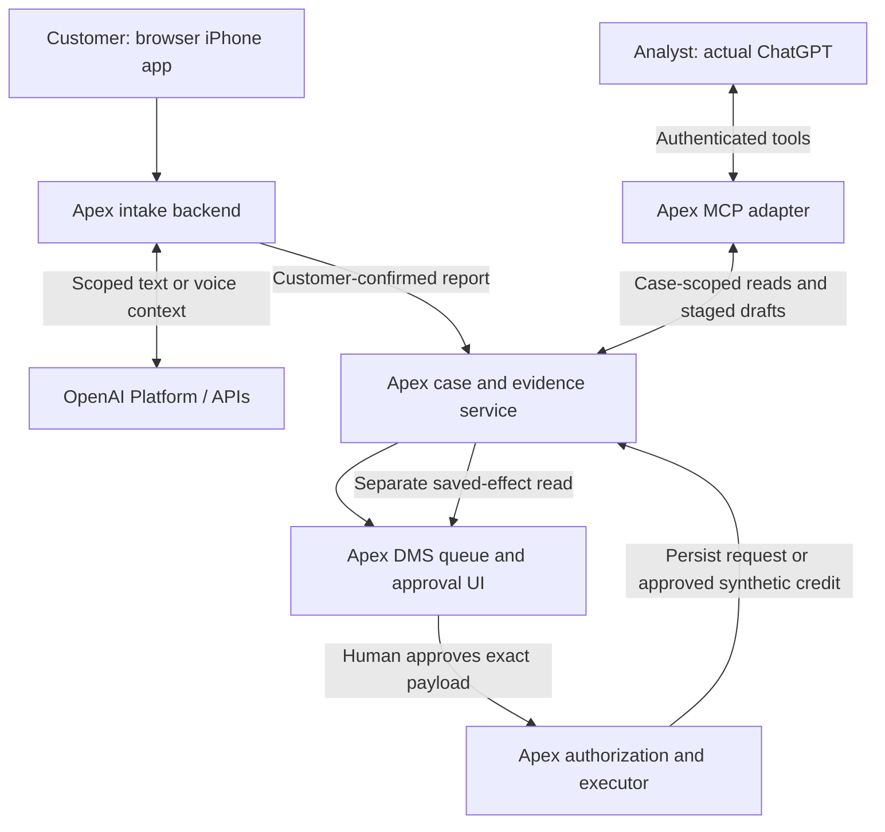

# Reference architecture, data flow, and connection proof

Prepared October 15, 2026. Target design; consult handoff.md for implemented behavior. The two selected OpenAI product surfaces are **Platform/APIs** for customer intake and **ChatGPT** for analyst investigation. Realtime voice and conversational text are alternative experiences within the first surface. Codex is a development aid, not a counted live surface.

## October 20 decision - Barbara approves the supported credit

Theo selected a completed consumer outcome: after further evidence, Barbara explicitly approves the $648.50 credit under a **fictional Apex analyst-authority policy for amounts below $1,000 when the reviewed evidence supports the dispute**. The threshold grants authority, not automatic entitlement or a fraud finding. Apex validates the action, posts a synthetic ledger credit, and separately reads the saved credit and case decision before displaying completion and the approved customer explanation. This supersedes the October 19 specialist-referral ending. Network recovery stays separate. Read [the current ending and proof requirements](case-resolution.md). Code still implements the earlier handoff; additional evidence, credit posting and customer-resolution flow remain unbuilt. No new runtime/model test or Gate 0 completion is implied.

## Intelligent UI feasibility check — Gate 0

Required planning step before further feature building; requested by Theo. It is a test of whether to use an optional evidence-comparison presentation in the existing analyst scene. It does not change the case contract or execution controls.

Official announcement checked October 15, 2026: native Intelligent UI is a Chat-tab feature, with Enterprise availability subject to admin settings. The announcement does not establish compatibility with Apex MCP tools or an embeddable API feature. A custom MCP component or browser widget must not be labeled native Intelligent UI.

| Check | Action / evidence to record | Current status |
| --- | --- | --- |
| Presentation-account availability | Identify actual account/workspace, Chat mode/model and browser; confirm native rendering is available. Do not assume Work/Codex behaves the same. | Not run |
| Useful evidence comparison | With a clearly labeled synthetic available-evidence snapshot, compare assertion/source/uncertainty, expand a source, and inspect legibility. Preserve source IDs/version and exclude unreleased findings. | Not run; snapshot rendering alone would not prove tools |
| Combined case retrieval and presentation | Once the minimal adapter is available, invoke get_case/get_evidence in the same Chat experience, render the comparison, verify references and changes after additional evidence. Record the actual tool trace and rendering. | Adapter/linking unbuilt; unproven |
| Failure and timing | Check stale or mismatched evidence, unavailable UI, refresh, and failed source links; retain a plain sourced table. Fit the comparison into the existing scene, proposed maximum 60 seconds. | Not run |

Proposed timebox: one 20-minute readiness session, not a requirement to solve every UI issue. Record one outcome before further feature building: USE AFTER PROOF (native rendering useful, with combined tool proof still explicitly pending if no adapter), DEFER (use sourced table), or UNAVAILABLE (use sourced table). Do not mark an untested combination as working. An availability/rendering decision permits only the minimal read-adapter proof next; repeat the combined check before investing in custom UI. If tool compatibility fails, keep the table and continue the core demo. This gate must not force a new Chat mode or weaker access control merely to obtain visuals.

## Named API and integration baseline

| Responsibility | Selected API / interface | Required behavior |
| --- | --- | --- |
| Conversational text intake | OpenAI Responses API, function calling and Structured Outputs where appropriate | Server validates output; preserve attribution; customer confirms before shared case submission |
| Browser voice alternative | OpenAI Realtime API over WebRTC | Backend-controlled session setup; no persistent API secret in browser; same confirmation/case contract; phone transport is separate and not assumed |
| Analyst investigation | Actual ChatGPT + custom MCP plugin, Streamable HTTP | get_case/get_evidence are truly read-only; validated identity/case access and source snapshots |
| Stage request / brief | Proposed MCP stage tools | Saving a draft is a write and may need ChatGPT confirmation; it cannot authorize Apex execution |
| Human-approved execution | Apex's own HTTP service and executor | Existing prototype is local-only; real actor authorization remains pending; verify exact persisted effects |
| Native Intelligent UI | ChatGPT presentation capability, conditional on Gate 0 | Evidence presentation only; no claim it is available as an API for the simulated iPhone app |

Model IDs/snapshots are not interchangeable with API selection. Before model evaluation, choose candidates supported by the actual account and required tools/schema, record exact IDs/versions and inference settings, then pin the evaluated configuration. The actual ChatGPT model/mode must also work with the tool connection and any native UI. None of these account-level combinations has yet been verified.

## Legacy DMS integration — locked October 20

**Fictional scenario assumption approved by Theo:** Apex retains a legacy dispute-management system with supported integration interfaces and existing enterprise identity. The DMS has no native MCP server. Its exact vendor and REST/SOAP/middleware interface remain unspecified; discovery validates actual interface coverage, permissions, cost and reliability.

Apex builds and operates an MCP adapter in front of those interfaces. ChatGPT calls focused tools such as get_case/get_evidence; the adapter validates delegated identity and case/source/action permissions, invokes the existing DMS/evidence services, minimizes the returned fields and produces a structured result. The DMS itself does not need to understand MCP. Consequential execution remains through Apex's separately authorized services and human approval, not a model-granted permission.

| Component | Responsibility |
| --- | --- |
| Actual ChatGPT | Interpret the request, invoke permitted tools and synthesize source-supported findings |
| Apex-owned MCP adapter | Expose narrow tool contracts; validate identity and resource/action authority; translate to supported existing interfaces; return permitted fields and source metadata |
| Existing DMS/integration services | Keep operational records, supported business operations and durable effects; remain authoritative |
| Current demo stand-in | Python/SQLite plus existing HTTP case/action services represent those systems; the MCP adapter and authenticated connection remain unbuilt |

This extends the existing system through a controlled integration layer. It does not assume the DMS vendor supplies MCP, require replacing the DMS or give ChatGPT unrestricted database/SQL access. If a backend uses a service credential rather than delegated user credentials, Apex must still enforce the requesting user's case/action entitlements; a shared credential cannot be treated as authorization for every employee.

A vendor supplying MCP does not by itself prove it embeds AI: MCP exposes capabilities to external AI clients. If native vendor AI also exists, compare whether it meets the same task, quality, control and total-cost requirements before adding another solution.

Customer-facing wording:

“We keep your existing DMS and add a controlled integration layer so ChatGPT can work with the records and actions you permit.”

Published OpenAI customer examples are precedents for parts of this operating pattern; they need not have Apex's exact fictional architecture. Do not infer private implementation details or transplant their results. [OpenAI's MCP server guidance](https://developers.openai.com/plugins/build/mcp-server) describes focused tools with authorizing operation handlers; checked October 20.

This is an approved scenario/design assumption, not evidence of a real bank integration, executed adapter, working identity or passing evaluation. Gate 0 and build sequencing remain unchanged.

## Codex in the implementation talk track — locked October 20

Theo requested including Codex as an implementation/maintenance aid for Apex's engineers. Keep this to approximately 20–30 seconds inside the architecture discussion, especially when the technology leader asks who builds and maintains the adapter. It is not a new demo scene or a third counted product surface.

Locked talk track:

“Your engineering team can use Codex to help build and test this integration layer around the DMS interfaces you already have. We'd start with a small set of case and evidence tools, integrate your existing identity controls, and test both permitted and denied access.

“Apex's engineers own the code, review the changes and approve releases. Codex helps with implementation and maintenance; the bank retains responsibility for the system.”

Candidate engineering work:
- Implement focused MCP tools around supported DMS/evidence interfaces.
- Integrate existing identity and authorization mechanisms; do not invent a new identity provider.
- Write/run meaningful checks for denied case access, sensitive-data filtering, unavailable evidence, failed actions and saved-effect verification.
- Help maintain tool contracts and integration code as interfaces and requirements change.

Codex can assist with coding, tests and review; this is not a guarantee of security, compliance, correctness or a delivery-time reduction. Engineers still review changes, evaluate behavior and approve releases. No new adapter/code/test was produced by this preparation update. [OpenAI engineering guidance](https://openai.com/business/solutions/engineering/) supports coding, testing and review workflows; checked October 20.

Selected runtime surfaces remain Platform/APIs for customer text OR voice intake and actual ChatGPT for analyst investigation. Existing Gate 0 and implementation-proof requirements remain unchanged.

## Target reference architecture

The same Apex case ID spans intake, queue, investigation, and execution. ChatGPT does not create a second case store. The MCP adapter enforces authenticated case access; the model cannot grant its own approval. Existing deadlines and durable operational records belong to Apex. Prototype saved-effect checks read the same SQLite store and are not confirmation from an external bank or second system.

## Analyst access and presentation surface — locked October 20

Read [the access-control design, role matrix, Project restrictions and published precedents](analyst-access-control.md). Actual ChatGPT on the web is the primary presentation candidate; Work/Project use requires account/tool proof and is not a new surface requirement. Workspace roles restrict app/tool access, while Apex validates delegated identity and enforces role plus case/source/action permission on every request. Project sharing can expose copied evidence; do not use a broadly shared cross-case workspace as the authorization boundary. A two-identity allowed/denied case retrieval remains required proof, not an executed result.

## Data and trust boundaries

| Stage | Data crossing the boundary | Authority and control |
| --- | --- | --- |
| Selected charge -> intake | Needed amount, merchant, date, transaction/case references; opaque customer reference and optional last-four | Target: Apex constructs an allowlisted payload and excludes full PAN, CVV/CVC, PIN, passwords and unrelated accounts before model transmission. Filtering remains unimplemented; see sensitive-data-and-voice.md. |
| Intake backend -> Platform | Cleared text and approved transaction fields; direct Realtime voice sends raw microphone audio | Server credentials, customer corrections and approved data/retention boundary. Voice must warn never to give full PAN/security code; warning or later transcript masking does not prevent raw-audio exposure. Strict exclusion needs validated upstream controls. |
| Customer confirmation -> case service | Attributed statement and confirmed structured report | Server validates session/transaction ownership and prevents duplicate submission |
| Case -> analyst tools | Authorized source excerpts, IDs, availability, snapshot/version | Case-level permissions; unavailable evidence bodies stay excluded; merchant documents are untrusted content, not tool instructions |
| Model -> staged action | Proposed request or cited investigation brief, exact destination and snapshot | Allowlisted schema; stage-only tools; deterministic identifiers and associations checked in code |
| Human -> executor | Exact reviewed payload with actor, expiry, and snapshot | Fresh authorization, stale-draft rejection, idempotency; synthetic credit now selected as target scope but unimplemented; no network filing |
| Executor -> read-back | Saved request ID/scope or exact synthetic credit and consumer decision | Verify persisted facts; distinguish failure, ambiguity, and later progression; do not infer success from status alone |

### Sensitive card data and voice requirement — October 20

Read [the locked field boundary, required voice opening, accidental-exposure handling and future verification](sensitive-data-and-voice.md). The current fixture uses card last-four, but free text has no PAN detector and model connections remain unbuilt. In the voice branch, explicitly tell the customer not to give a full card number or security code and never request them. Direct Realtime audio can still contain volunteered numbers; model instructions are not a pre-transmission data boundary. The specification and tests are requirements, not executed controls or a production assurance claim.

### Tool confirmation versus business approval

Official custom-MCP guidance says write tools require confirmation by default and honors readOnlyHint for reads. Mark get_case/get_evidence read-only only because they do not mutate state. Draft-persisting stage tools remain writes. In the revised three-action demo, internal lookup, processor follow-up and credit each require Apex approval, with separate ChatGPT staging permissions where applicable; rehearse the actual count and timing, rather than assuming one approval prompt per action. Account setup/OAuth consent is a separate preparation step.

Narration: "ChatGPT is asking permission to call the staging tool. Apex's approval is the bank-authorized decision to execute this exact action." Do not suppress necessary prompts by mislabeling tools or treat a remembered tool permission as business authority. Installation/confirmation behavior must be rehearsed on the presentation account.

Minimal proposed tools: get_case(case_id), get_evidence(case_id, source_id, snapshot), stage_evidence_request(case_id, snapshot, scope), stage_credit(case_id, snapshot, amount, rationale, customer_message), and get_action_result(case_id, action_id). Names/contracts are proposed, not implemented MCP tools. Execution approval remains an Apex human operation; it is not exposed as a model approval tool.

## Current versus target

| Component | Current repo | Remaining proof |
| --- | --- | --- |
| iPhone appearance | Browser banking shell and local draft form | Conversational intake and shared case creation |
| Case/evidence | One seeded APX-001 case; SQLite transitions | Submitted-report continuity, queue, real identity/ACLs |
| Assessment | Explicit fixed server-side text, release-gated | Actual model synthesis with sources and snapshots |
| Execution | Local operator approval and persisted-effect checks | Authenticated authority, full cited brief, failure reconciliation |
| OpenAI connections | Neither surface connected | Platform intake and actual ChatGPT tool invocation |

## Smallest actual ChatGPT connection proof

Documentation checked October 15, 2026. Current official instructions connect a custom MCP server as a plugin through ChatGPT on the web; workspace restrictions apply. Streaming HTTP and SSE are supported. A connection can use a server URL or supported Secure MCP Tunnel. Current tool-call details expose inputs and outputs. This is verified product guidance, not evidence this account or Apex connection works. See sources below.

1. Check that the intended presentation account/workspace can add and install a custom MCP plugin. Record the actual setup used; do not assume an old developer-mode menu.
2. Build a separate MCP adapter around the existing case service using an official SDK and Streamable HTTP. REST /api/case is not itself MCP. Start with get_case and get_evidence only.
3. Use an established identity provider and OAuth 2.1 metadata/PKCE for the authenticated target. Enforce token validation and case ACLs on each read. Do not build a new identity provider for this demo.
4. Make the adapter reachable through the supported secure tunnel or an authenticated HTTPS deployment. Do not expose the unauthenticated local /api/action server through a public tunnel. Host/origin hardening must match the chosen environment.
5. Install/link in actual ChatGPT and explicitly invoke Apex get_case for APX-001, followed by an available source. Capture the tool input/output and generated answer with source IDs.
6. Run a denied-case attempt using a separate restricted test identity or fixture, plus a withheld-source request. Confirm the server denies access and does not release the body. Then add stage-only tools in a later increment.

Pass evidence: real ChatGPT tool trace, expected case/source content, source-based answer, and denial/release checks. MCP Inspector alone, an API-backed custom chat, a screenshot of a connected icon, or a mocked transcript does not prove this milestone. As of this preparation update, only the documentation path is verified. Adapter, identity configuration, account linking, and live invocation remain unexecuted. If unavailable, use a labeled simulation for the meeting and explain the remaining dependency.

## Regulatory and data context

These are scoped design implications, not an automated legal decision engine. Bank counsel/compliance must validate applicability, disclosures, retention, and notice handling before live customer use.

| Primary reference | Verified context and design implication |
| --- | --- |
| CFPB Regulation Z 1026.13(b), (c), (f) | Qualifying billing-error notices have form/timing conditions. Electronic notice can meet the written requirement through the creditor's disclosed accepted means. Acknowledgment is generally due in 30 days unless resolved; resolution in two complete billing cycles, no later than 90 days. A no-error result requires reasonable investigation, explanation, and documentary evidence on request. Apex tracks triggers/deadlines; pending evidence does not pause them. |
| CFPB Regulation Z 1026.12(b)(3) and commentary | Possible unauthorized-use notification may be given by telephone; protections are independent of 1026.13's written-notice/time requirements. Capture a call promptly and preserve notice provenance; never imply a customer has no protection until completing the app form. |
| Bank data/security review | Minimize identifiers, approve vendor terms and actual retention configuration, encrypt transport/storage, segregate environments, restrict access and redact logs. These are proposed controls; this repo proves no production privacy certification. |

Consumer liability, network remedies, and Apex synthetic referral policy remain separate. No Reg E 10-day provisional-credit rule is imported into this credit-card scenario. CE 3.0 eligibility is not needed for this demo. Model-risk/vendor-risk owners determine applicable governance; do not cite old SR 11-7 as current without checking its successor and scope.

## Primary sources

- [Intelligent UI announcement](https://openai.com/index/gpt-6-for-everyone/)
- [Responses text generation](https://developers.openai.com/api/docs/guides/text)
- [Structured Outputs](https://developers.openai.com/api/docs/guides/structured-outputs)
- [Realtime WebRTC](https://developers.openai.com/api/docs/guides/voice-webrtc)
- [ChatGPT custom MCP connection](https://developers.openai.com/api/docs/guides/custom-mcp-server)
- [MCP authentication](https://developers.openai.com/plugins/build/auth)
- [CFPB 1026.13](https://www.consumerfinance.gov/rules-policy/regulations/1026/13/)
- [CFPB 1026.12](https://www.consumerfinance.gov/rules-policy/regulations/1026/12/)
- [Federal Reserve SR 26-2](https://www.federalreserve.gov/supervisionreg/srletters/SR2602.htm): identifies replacement of SR 11-7; assess applicability rather than claiming all generative systems fall within it.

Recheck source/configuration details before final rehearsal. Full interview uploads, tokens, traces containing customer data, and proprietary material do not belong in this public repo.
